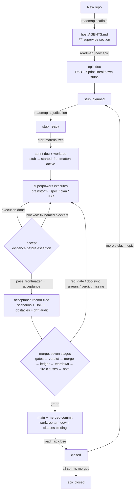
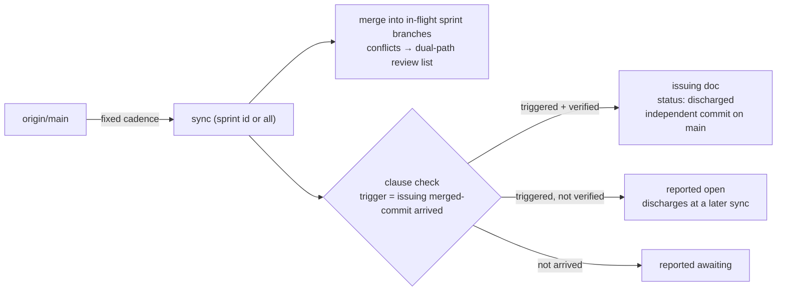

# SuperVibe

**Iteration management for Claude Code.** SuperVibe answers *what to build, in
what order, when a sprint is done, and when it may merge* — the strategy layer.
It pairs with [superpowers](https://github.com/obra/superpowers), the tactics
layer that answers *how to write the code well*.

| | SuperVibe (strategy) | superpowers (tactics) |
|---|---|---|
| Cares about | roadmap, sprint scheduling, DoD, acceptance, merge close-out, cross-sprint sync | brainstorm, spec, plan, TDD, subagent-driven dev, review loops |
| Input | roadmap + in-flight sprints | one sprint plan doc |
| Output | adjudication: "this sprint may start / may merge" | working code + docs |

The two layers couple through an **artifact contract**, not code: a sprint plan
doc and an acceptance record. SuperVibe never forks or rewrites a superpowers
skill.

## Default multi-agent iteration, explicit solo exit

The coordinator is the **current main agent**, never an extra spawned coordinator. At Roadmap kickoff, explicitly confirm `independentAcceptance`: false assigns acceptance to the main agent; true uses a distinct acceptance worker (same harness allowed), with main-agent final review. Acceptance shares the existing worker cap; cap 1 supports sequential distinct workers. Every acceptance wake/resume rechecks candidate/build, scenario-required environment/tools/accounts/data and evidence capture; missing or unknown conditions block, not silently downgrade. See [acceptance ownership and self-check](docs/collaboration-modes.md#acceptance-ownership-and-wake-self-check--验收归属与唤醒自检).

SuperVibe defaults to a coordinating main agent plus workers for an overall iteration. Choose native harness orchestration (such as Claude Code subagents) or external Orca orchestration, and confirm worker count and applicable worker harnesses at kickoff. `maxWorkers: 1` means one worker **plus** the coordinator. Missing selected capabilities block execution; they never silently turn multi-agent work into solo work.

Explicit single-agent/no-subagent work goes directly to **superpowers**, before any SuperVibe scaffold, ledger initialization, configuration, reservation or iteration artifact. It does not activate iteration mode; solo is not a third collaboration mode. `scripts/iteration-route.mjs` is a pure intent router, not a runtime launcher.

Acceptance is planned up front at **two distinct scopes**: each sprint's scenarios, and the Roadmap's final integrated outcomes. Universal DoD is the shared quality baseline, not a requirement that each sprint deliver the entire roadmap. CI/CD success does not replace real user acceptance: UI scenarios require real browser actions, observed outcomes and artifact evidence. Missing, not-run or substituted mandatory evidence blocks acceptance. All planned sprints must be landed, and a separate fresh overall acceptance must pass against current integrated content before Roadmap closure. Structural/provenance checks do not prove that browser evidence is authentic.

## Terminology (deliberately Scrum-aligned)

Core nouns come straight from Scrum — nothing new to learn: **epic**, **sprint**,
**Definition of Done (DoD)**, **story/task**, **acceptance scenarios**.

Two explicit differences from standard Scrum:

- **A sprint is a value box, not a time box.** Close-out criterion is DoD met,
  not the calendar. A WIP limit (default 3) controls parallelism. No fixed
  length, no velocity.
- **DoD lives at the epic level.** Sprint docs copy it verbatim; it is never
  edited in place inside a sprint doc.

Four nouns with no Scrum equivalent — SuperVibe's own capabilities:

- **sprint ledger** — the shared runtime state in the Git common directory; sprint
  frontmatter is a readable, versioned projection
- **handover clause** — a cross-sprint re-verification obligation ("when my
  change lands, you must re-check X")
- **early start** — safely opening a new sprint line before the previous one
  has closed
- **deferred dependency** — building against a target sprint as if already
  merged, with a handover clause as the safety net

## Artifacts

All artifacts are dated markdown files under the host repo's `docs/superpowers/`
(defaults; configurable):

```
docs/superpowers/
├── specs/          2026-10-01-<feature>.md     design docs (superpowers domain)
├── plans/          2026-10-01-<feature>.md     implementation plans (superpowers domain)
├── roadmaps/       2026-10-01-<epic>.md        epic docs: DoD, sprint breakdown, ADRs, open questions
├── sprints/        2026-10-01-S#-<name>.md     sprint docs: ledger frontmatter, stories, scenarios, clauses
└── acceptances/    2026-10-01-S#-acceptance.md acceptance records: evidence, verdict
```

Sprint runtime state is a **shared ledger** at `<git common-dir>/supervibe/state.json`.
All linked worktrees use one authority for reservations, WIP and transitions.
Markdown keeps planning, DoD, scenarios, evidence and readable state projections;
branch-local state labels cannot authorize a start or merge. Pre-start
`planned`/`ready` remains in epic planning stubs. See [the shared-state protocol](docs/shared-ledger.md)
for explicit init/import, revision-CAS mutations and crash recovery.

## Lifecycle

Main chain (roadmap → start → execution → accept → merge → close):



Sync side (fixed cadence, independent of the main chain):



Key points:

- **Two state namespaces**: stub rows own `planned → ready → started`; shared runtime owns `reserved → active → acceptance → merged → closed`; frontmatter projects it
- **Clause lifecycle in three acts**: registered at `start`, fired binding at `merge` stage 6, discharged at `sync`
- **Rework loops**: an accept `blocked` returns to execution; a merge red returns to execution/accept, and merge re-runs from stage 1 after the fix — a half-green run proves nothing
- **Parallelism**: `reserved`, `active`, and `acceptance` count toward `wip_limit` (default 3); with several lines in flight, `sync` is the drift fence

## Shared state and deterministic guards

`shared-ledger.mjs` owns the local runtime state under Git common-dir with a
mkdir lock, revision checks, operation IDs and atomic JSON replacement. Explicit
init/import is required; no branch-local fallback exists. `reserve` atomically
claims WIP before carrier creation, `activate` completes startup, and review,
landing and close commands own their transitions. A failed start retains its
reservation for recovery. Independent clones do not share runtime state.

`validate-workflow.mjs` binds acceptance to a reviewed-file fingerprint.
`review-pass` requires a clean committed candidate and stores its commit/tree;
`check` blocks a changed candidate before merge. The fingerprint excludes only
the exact new acceptance record and three review metadata fields, not whole
folders. External systems and ignored build output still need real verification.
Legacy acceptance requires revocation and fresh review during explicit import.

Markdown and the board are projections, never WIP authority. The shared ledger
is Git metadata, not pushed source; a fresh clone needs explicit initialization.
A local lock is not a remote merge lock. Host merge protection and actual scenario
evidence remain required. Submodules, unsupported multiline frontmatter and
unresolved conflicts fail closed. Scaffold preserves empty owned directories
with committed `.gitkeep`; already-landed merge recovery never merges twice.

## Scripted mechanical preflight

Fixed parsing and checks live in scripts, not repeated Agent checklists:
`host-config.mjs` reads strict host configuration, `artifact-inventory.mjs`
resolves identities and projection/carrier anomalies, and `doc-sync.mjs` checks
per-commit document obligations. `clause-ids.mjs` reserves HC IDs atomically after
explicit legacy bootstrap. Business judgment, authorization and real acceptance
observations remain with the Agent. See [mechanical commands](docs/mechanical-preflight.md)
and [clause ID migration](docs/clause-id-allocation.md).

At overall iteration kickoff, ask once for the concurrent worker cap; native inherits the current harness, while Orca asks for worker harness(es) and explicit mixed-mode permission. Save the user-confirmed policy in the local shared ledger and reuse it on resume. No default cap; no automatic spawning. Cap and harness contracts are validated, but real backend capacity admission remains the coordinator’s responsibility.

## Development resource coordination

Before environment-heavy parallel work, assess local CPU/memory/disk and workload
footprints, then confirm budgets separately from worker limits. Atomic exclusive
resource groups coordinate containers, ports, databases, profiles and accounts;
required acceptance groups are checked against the frozen candidate. Optional SSH
hosts are resource-environment metadata, not an automatic connection/provisioning
adapter. See [resource protocol and limits](docs/resources.md).

## Board

A bundled static viewer of the Markdown projection, not the live runtime ledger. Say "board" and
`supervibe:board` generates `.agents/board/` in the host repo (page +
parser + baked `board-data.js`); opening that page shows every epic with its
full breakdown immediately — sprint cards grouped by state (stub rows
included), detail drawer with DoD, scenarios, handover clauses and wave-plan
links. Zero folder picking; refresh by re-running the skill (baked data is a
generation-time snapshot).

Zero network, zero build: parsing happens in the page's memory (classic
script `web/parser.js`), nothing is written to disk by the page itself, and
no index file ever lands in the repo. The plugin copy of `web/board.html`
keeps a folder picker as fallback. Rendering gaps surface as visible data
smells in the warning bar, never silent drops. Design:
`docs/superpowers/specs/2026-10-01-board-design.md`.

## Install

```
/plugin marketplace add WayJ/supervibe
/plugin install supervibe@supervibe
```

Local development:

```
claude --plugin-dir /path/to/supervibe
```

## The six skills

| skill | one line |
|---|---|
| `supervibe:roadmap` | create/close epics, scaffold the config section, manage debt, adjudicate stub rows |
| `supervibe:start` | materialize a stub row into a sprint doc + worktree; register handover clauses |
| `supervibe:accept` | run acceptance scenarios with fresh evidence, audit doc drift, issue the verdict |
| `supervibe:complete` | seven-stage close-out: gates → verdict → merge → ledger → teardown → fire clauses → note |
| `supervibe:sync` | event-driven merge of `origin/main` into in-flight sprints; check and discharge handover clauses; durable report note |
| `supervibe:board` | generate a local read-only snapshot of epics, sprints, and handover clauses |

Every skill ships bilingual: `SKILL.md` (English truth source) + `SKILL.zh.md`
(faithful Chinese mirror).

## Agent collaboration modes

Exactly two explicit routes: **native / harness** uses the current harness's own orchestration (such as Claude Code subagents); **external / orca** delegates to Orca CLI for cross-session/cross-harness orchestration. SuperVibe defines the shared task/result contract, not its own scheduler. Superpowers supplies execution methods, not a third mode.

Select `collaboration_mode` and `collaboration_provider` in host config; an unset or unavailable route blocks delegation, with no silent fallback. Shared state remains local to one Git common-dir. **Contract/fixture-tested, not live native/Orca E2E-verified.** See [configuration, boundaries and receipts](docs/collaboration-modes.md).

## Host configuration

Zero stack assumptions: every project-specific value (paths, gate commands,
WIP limit, doc-sync map) lives in the host repo's `AGENTS.md`, in a `## supervibe`
section:

```markdown
## supervibe
- roadmaps_dir: docs/superpowers/roadmaps/
- sprints_dir: docs/superpowers/sprints/
- acceptances_dir: docs/superpowers/acceptances/
- notes: .agents/notes/
- debt_tracker: docs/tech-debt-tracker.md
- wip_limit: 3

### gates
- contracts: npm run test:contracts
- tests: npm test

### doc_sync_map
| change | owes |
|---|---|
| `src/db/schema.ts` | docs/generated/db-schema.md |
```

Run `supervibe:roadmap` with `scaffold` to generate this section in a new repo.

## Without superpowers

SuperVibe detects superpowers and dispatches to it (brainstorming, spec
writing, TDD). Without it, the same artifact contract is produced manually —
the artifacts are plain markdown, and the process degrades, not breaks. No hard
dependency is declared.

## Scripted mechanical preflight

Fixed parsing and checks live in scripts, not repeated Agent checklists:
`host-config.mjs` reads strict host configuration, `artifact-inventory.mjs`
resolves identities and projection/carrier anomalies, and `doc-sync.mjs` checks
per-commit document obligations. `clause-ids.mjs` reserves HC IDs atomically after
explicit legacy bootstrap. Business judgment, authorization and real acceptance
observations remain with the Agent. See [mechanical commands](docs/mechanical-preflight.md)
and [clause ID migration](docs/clause-id-allocation.md).

At overall iteration kickoff, ask once for the concurrent worker cap; native inherits the current harness, while Orca asks for worker harness(es) and explicit mixed-mode permission. Save the user-confirmed policy in the local shared ledger and reuse it on resume. No default cap; no automatic spawning. Cap and harness contracts are validated, but real backend capacity admission remains the coordinator’s responsibility.

## Development

```
claude plugin validate . --strict   # plugin/marketplace manifest check
node tests/check-artifacts.mjs      # bilingual pairing, template completeness, assembly dry-run
node --test tests/*.test.mjs
```

Zero npm dependencies; Node ≥ 20.

## License

MIT
